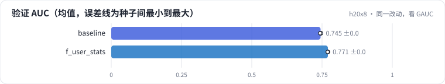

<!-- 本页由 python -m labkit docs 从 ../lesson.yaml 和 results/ 生成，不要手改 -->

[← 加用户历史统计](08-user-stats.md) · [课程首页](../README.md) · [收益落在哪类用户 →](10-group.md)

# 第 9 步 / 共 19 步：同一改动，看 GAUC

> 阶段 4 / 7：**逐组加特征** · 场景：`f_user_stats`（对照 `baseline`）

同一个场景（+用户历史统计），换成 GAUC：每个用户内部的排序。

## 这一步跑了什么

| 场景 | 作用 | 说明 | 相对基线改了什么 | 种子（H20） |
| - | - | - | - | - |
| `baseline` | 对照 | 基线：只用用户 ID + 电影 ID（= R0a 基线），5 个种子 | — | 5 |
| `f_user_stats` | 本步 | + 用户历史统计（此前评分次数、平滑喜欢率，时点正确） | `feature_groups=['ids', 'user_stats']` | 3 |

## 先预测

**加用户历史统计，验证 GAUC 涨多少？**

- **A.** 不到 0.5 个点
- **B.** 0.5 - 2 个点
- **C.** 2 个点以上

> 先选定一个（记下来），再展开下面的实测。AUC 差异小于 0.3 个百分点（GAUC 小于 0.5）或小于种子间波动，都按“差不多”算。

## 实测

展开实测：H20 · MovieLens-1M 全量 · 在 R0a 基线上逐组加特征、换统计口径 · 3-5 种子（已有 8 / 8 个运行）

| 场景 | 类型 | 验证 AUC | 验证 GAUC | GAUC 覆盖行占比 | 验证 AUC：与 `baseline` 差 | 验证 AUC：各种子 | 断言 |
| - | - | - | - | - | - | - | - |
| `baseline` | 基线 | 0.7449 ± 0.0015 | 0.7304 ± 0.0004 | 99.6% ± 0.0% | — | s0 0.7447 / s1 0.7437 / s2 0.7458 / s3 0.7469 / s4 0.7433 | 通过 |
| `f_user_stats` | 候选改动 | 0.7708 ± 0.0007 | 0.7292 ± 0.0003 | 99.6% ± 0.0% | +0.0259 | s0 0.7713 / s1 0.7711 / s2 0.7700 | 通过 |

运行目录（每个目录里有 `summary.json` 指标、`evidence.json` 证据摘要、`predictions.jsonl` 逐条预测、`log.txt` 日志）：

- `baseline` [s0](../../../results/h20x8/R0b/baseline/s0-461376/) · [s1](../../../results/h20x8/R0b/baseline/s1-71c585/) · [s2](../../../results/h20x8/R0b/baseline/s2-570ea7/) · [s3](../../../results/h20x8/R0b/baseline/s3-a5952b/) · [s4](../../../results/h20x8/R0b/baseline/s4-e7e664/)
- `f_user_stats` [s0](../../../results/h20x8/R0b/f_user_stats/s0-00e791/) · [s1](../../../results/h20x8/R0b/f_user_stats/s1-7d80a6/) · [s2](../../../results/h20x8/R0b/f_user_stats/s2-2b8070/)

## 看完实测再想一步

AUC 和 GAUC 的涨幅差几倍？

---

[← 加用户历史统计](08-user-stats.md) · [课程首页](../README.md) · [收益落在哪类用户 →](10-group.md)
