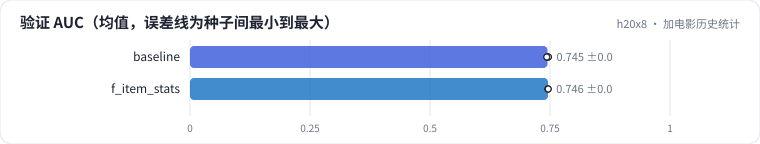

<!-- 本页由 python -m labkit docs 从 ../lesson.yaml 和 results/ 生成，不要手改 -->

[← 收益落在哪类用户](10-group.md) · [课程首页](../README.md) · [5 组全加 →](12-all.md)

# 第 11 步 / 共 19 步：加电影历史统计

> 阶段 4 / 7：**逐组加特征** · 场景：`f_item_stats`（对照 `baseline`）

对称地加电影侧：样本时刻之前被评了多少次、平滑喜欢率。时点正确。

## 这一步跑了什么

| 场景 | 作用 | 说明 | 相对基线改了什么 | 种子（H20） |
| - | - | - | - | - |
| `baseline` | 对照 | 基线：只用用户 ID + 电影 ID（= R0a 基线），5 个种子 | — | 5 |
| `f_item_stats` | 本步 | + 电影历史统计（此前被评分次数、平滑喜欢率，时点正确） | `feature_groups=['ids', 'item_stats']` | 3 |

## 先预测

**加电影历史统计，验证 AUC 会怎样？**

- **A.** 涨 0.3 个点以上
- **B.** 差不多（±0.3）
- **C.** 跌 0.3 个点以上

> 先选定一个（记下来），再展开下面的实测。AUC 差异小于 0.3 个百分点（GAUC 小于 0.5）或小于种子间波动，都按“差不多”算。

## 实测

展开实测：H20 · MovieLens-1M 全量 · 在 R0a 基线上逐组加特征、换统计口径 · 3-5 种子（已有 8 / 8 个运行）

| 场景 | 类型 | 验证 AUC | 验证 GAUC | 长尾电影 AUC | 验证 AUC：与 `baseline` 差 | 验证 AUC：各种子 | 断言 |
| - | - | - | - | - | - | - | - |
| `baseline` | 基线 | 0.7449 ± 0.0015 | 0.7304 ± 0.0004 | 0.7177 ± 0.0041 | — | s0 0.7447 / s1 0.7437 / s2 0.7458 / s3 0.7469 / s4 0.7433 | 通过 |
| `f_item_stats` | 候选改动 | 0.7459 ± 0.0003 | 0.7324 ± 0.0002 | 0.7240 ± 0.0020 | +0.0010 | s0 0.7456 / s1 0.7458 / s2 0.7462 | 通过 |

运行目录（每个目录里有 `summary.json` 指标、`evidence.json` 证据摘要、`predictions.jsonl` 逐条预测、`log.txt` 日志）：

- `baseline` [s0](../../../results/h20x8/R0b/baseline/s0-461376/) · [s1](../../../results/h20x8/R0b/baseline/s1-71c585/) · [s2](../../../results/h20x8/R0b/baseline/s2-570ea7/) · [s3](../../../results/h20x8/R0b/baseline/s3-a5952b/) · [s4](../../../results/h20x8/R0b/baseline/s4-e7e664/)
- `f_item_stats` [s0](../../../results/h20x8/R0b/f_item_stats/s0-e98695/) · [s1](../../../results/h20x8/R0b/f_item_stats/s1-d8eac2/) · [s2](../../../results/h20x8/R0b/f_item_stats/s2-cd70a2/)

## 看完实测再想一步

和"加用户统计"放在一起看，为什么两边不对称？

---

[← 收益落在哪类用户](10-group.md) · [课程首页](../README.md) · [5 组全加 →](12-all.md)
