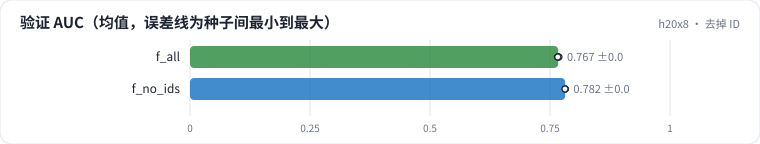

<!-- 本页由 python -m labkit docs 从 ../lesson.yaml 和 results/ 生成，不要手改 -->

[← 5 组全加](12-all.md) · [课程首页](../README.md) · [换成 DCN-v2 →](14-dcn.md)

# 第 13 步 / 共 19 步：去掉 ID

> 阶段 4 / 7：**逐组加特征** · 场景：`f_no_ids`（对照 `f_all`）

在"全部特征"上只去掉用户 ID 和电影 ID 两张表，其余 4 组不变。embedding 参数少了九成以上。

## 这一步跑了什么

| 场景 | 作用 | 说明 | 相对基线改了什么 | 种子（H20） |
| - | - | - | - | - |
| `f_all` | 对照 | 5 组特征全加（时点正确），5 个种子 | `feature_groups=['ids', 'user_profile', 'item_attr', 'user_stats', 'item_stats']` | 5 |
| `f_no_ids` | 本步 | 全部特征去掉用户 ID 和电影 ID（其余 4 组不变） | `feature_groups=['user_profile', 'item_attr', 'user_stats', 'item_stats']` | 3 |

## 先预测

**去掉 ID，验证 AUC 会怎样？**

- **A.** 涨 0.3 个点以上
- **B.** 差不多（±0.3）
- **C.** 跌 0.3 个点以上

> 先选定一个（记下来），再展开下面的实测。AUC 差异小于 0.3 个百分点（GAUC 小于 0.5）或小于种子间波动，都按“差不多”算。

## 实测

展开实测：H20 · MovieLens-1M 全量 · 在 R0a 基线上逐组加特征、换统计口径 · 3-5 种子（已有 8 / 8 个运行）

| 场景 | 类型 | 验证 AUC | 验证 GAUC | 留出 AUC | 没见过的用户 AUC | embedding 参数 | 验证 AUC：与 `f_all` 差 | 验证 AUC：各种子 | 断言 |
| - | - | - | - | - | - | - | - | - | - |
| `f_all` | 修复 | 0.7670 ± 0.0014 | 0.7330 ± 0.0005 | 0.7676 ± 0.0009 | 0.7585 ± 0.0013 | 293,536.0 ± 0.0 | — | s0 0.7675 / s1 0.7675 / s2 0.7651 / s3 0.7688 / s4 0.7663 | 通过 |
| `f_no_ids` | 候选改动 | 0.7817 ± 0.0004 | 0.7258 ± 0.0003 | 0.7787 ± 0.0001 | 0.7760 ± 0.0001 | 3,488.0 ± 0.0 | +0.0146 | s0 0.7818 / s1 0.7820 / s2 0.7812 |  |

运行目录（每个目录里有 `summary.json` 指标、`evidence.json` 证据摘要、`predictions.jsonl` 逐条预测、`log.txt` 日志）：

- `f_all` [s0](../../../results/h20x8/R0b/f_all/s0-55a121/) · [s1](../../../results/h20x8/R0b/f_all/s1-b243f6/) · [s2](../../../results/h20x8/R0b/f_all/s2-dd3fa1/) · [s3](../../../results/h20x8/R0b/f_all/s3-2ff37a/) · [s4](../../../results/h20x8/R0b/f_all/s4-7ddea0/)
- `f_no_ids` [s0](../../../results/h20x8/R0b/f_no_ids/s0-f42921/) · [s1](../../../results/h20x8/R0b/f_no_ids/s1-2e2055/) · [s2](../../../results/h20x8/R0b/f_no_ids/s2-daddc4/)

## 看完实测再想一步

AUC 和 GAUC 的方向一致吗？

---

[← 5 组全加](12-all.md) · [课程首页](../README.md) · [换成 DCN-v2 →](14-dcn.md)
