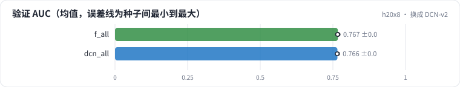

<!-- 本页由 python -m labkit docs 从 ../lesson.yaml 和 results/ 生成，不要手改 -->

[← 去掉 ID](13-no-ids.md) · [课程首页](../README.md) · [T+1 天级统计 →](15-daily.md)

# 第 14 步 / 共 19 步：换成 DCN-v2

> 阶段 4 / 7：**逐组加特征** · 场景：`dcn_all`（对照 `f_all`）

特征不变（全部 5 组），结构从 MLP 换成"MLP 并联 3 层 DCN-v2 cross"：显式建模特征之间的交叉。

## 这一步跑了什么

| 场景 | 作用 | 说明 | 相对基线改了什么 | 种子（H20） |
| - | - | - | - | - |
| `f_all` | 对照 | 5 组特征全加（时点正确），5 个种子 | `feature_groups=['ids', 'user_profile', 'item_attr', 'user_stats', 'item_stats']` | 5 |
| `dcn_all` | 本步 | 全部特征 + DCN-v2（MLP 并联 3 层 cross） | `feature_groups=['ids', 'user_profile', 'item_attr', 'user_stats', 'item_stats']`, `arch=dcn` | 3 |

## 先预测

**换成 DCN-v2，验证 AUC 会怎样？**

- **A.** 涨 0.3 个点以上
- **B.** 差不多（±0.3）
- **C.** 跌 0.3 个点以上

> 先选定一个（记下来），再展开下面的实测。AUC 差异小于 0.3 个百分点（GAUC 小于 0.5）或小于种子间波动，都按“差不多”算。

## 实测

展开实测：H20 · MovieLens-1M 全量 · 在 R0a 基线上逐组加特征、换统计口径 · 3-5 种子（已有 8 / 8 个运行）

| 场景 | 类型 | 验证 AUC | 验证 GAUC | 总参数 | 训练秒数 | 验证 AUC：与 `f_all` 差 | 验证 AUC：各种子 | 断言 |
| - | - | - | - | - | - | - | - | - |
| `f_all` | 修复 | 0.7670 ± 0.0014 | 0.7330 ± 0.0005 | 409,761.0 ± 0.0 | 1.6 ± 0.0 | — | s0 0.7675 / s1 0.7675 / s2 0.7651 / s3 0.7688 / s4 0.7663 | 通过 |
| `dcn_all` | 候选改动 | 0.7656 ± 0.0014 | 0.7333 ± 0.0002 | 725,985.0 ± 0.0 | 1.8 ± 0.0 | -0.0015 | s0 0.7646 / s1 0.7672 / s2 0.7649 |  |

运行目录（每个目录里有 `summary.json` 指标、`evidence.json` 证据摘要、`predictions.jsonl` 逐条预测、`log.txt` 日志）：

- `f_all` [s0](../../../results/h20x8/R0b/f_all/s0-55a121/) · [s1](../../../results/h20x8/R0b/f_all/s1-b243f6/) · [s2](../../../results/h20x8/R0b/f_all/s2-dd3fa1/) · [s3](../../../results/h20x8/R0b/f_all/s3-2ff37a/) · [s4](../../../results/h20x8/R0b/f_all/s4-7ddea0/)
- `dcn_all` [s0](../../../results/h20x8/R0b/dcn_all/s0-b69adc/) · [s1](../../../results/h20x8/R0b/dcn_all/s1-83ab74/) · [s2](../../../results/h20x8/R0b/dcn_all/s2-3bdaf4/)

## 看完实测再想一步

差值和"只换种子"的波动比呢？

---

[← 去掉 ID](13-no-ids.md) · [课程首页](../README.md) · [T+1 天级统计 →](15-daily.md)
