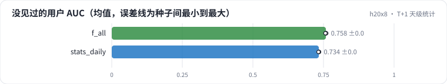

<!-- 本页由 python -m labkit docs 从 ../lesson.yaml 和 results/ 生成，不要手改 -->

[← 换成 DCN-v2](14-dcn.md) · [课程首页](../README.md) · [全量统计 →](16-fault.md)

# 第 15 步 / 共 19 步：T+1 天级统计

> 阶段 5 / 7：**统计的时效** · 场景：`stats_daily`（对照 `f_all`）

统计特征改成 T+1 天级：只用样本**前一天及更早**的评分（天级离线任务的产出）。不含未来，线上也能拿到——只是晚了一天。其余和"全部特征"相同。

## 这一步跑了什么

| 场景 | 作用 | 说明 | 相对基线改了什么 | 种子（H20） |
| - | - | - | - | - |
| `f_all` | 对照 | 5 组特征全加（时点正确），5 个种子 | `feature_groups=['ids', 'user_profile', 'item_attr', 'user_stats', 'item_stats']` | 5 |
| `stats_daily` | 本步 | 全部特征，统计改成 T+1 天级（只用样本前一天及更早的行为） | `feature_groups=['ids', 'user_profile', 'item_attr', 'user_stats', 'item_stats']`, `stats_mode=daily` | 3 |

## 先预测

**改成天级统计，"训练集没见过的用户"这一组 AUC 掉多少？**

- **A.** 掉不到 0.5 个点
- **B.** 掉 0.5 - 2 个点
- **C.** 掉 2 个点以上

> 先选定一个（记下来），再展开下面的实测。AUC 差异小于 0.3 个百分点（GAUC 小于 0.5）或小于种子间波动，都按“差不多”算。

## 实测

展开实测：H20 · MovieLens-1M 全量 · 在 R0a 基线上逐组加特征、换统计口径 · 3-5 种子（已有 8 / 8 个运行）

| 场景 | 类型 | 没见过的用户 AUC | 见过的用户 AUC | 验证 AUC | 留出 AUC | 没见过的用户 AUC：与 `f_all` 差 | 没见过的用户 AUC：各种子 | 断言 |
| - | - | - | - | - | - | - | - | - |
| `f_all` | 修复 | 0.7585 ± 0.0013 | 0.7920 ± 0.0017 | 0.7670 ± 0.0014 | 0.7676 ± 0.0009 | — | s0 0.7590 / s1 0.7595 / s2 0.7573 / s3 0.7599 / s4 0.7568 | 通过 |
| `stats_daily` | 候选改动 | 0.7336 ± 0.0012 | 0.7857 ± 0.0021 | 0.7469 ± 0.0013 | 0.7551 ± 0.0008 | -0.0249 | s0 0.7343 / s1 0.7343 / s2 0.7323 | 通过 |

运行目录（每个目录里有 `summary.json` 指标、`evidence.json` 证据摘要、`predictions.jsonl` 逐条预测、`log.txt` 日志）：

- `f_all` [s0](../../../results/h20x8/R0b/f_all/s0-55a121/) · [s1](../../../results/h20x8/R0b/f_all/s1-b243f6/) · [s2](../../../results/h20x8/R0b/f_all/s2-dd3fa1/) · [s3](../../../results/h20x8/R0b/f_all/s3-2ff37a/) · [s4](../../../results/h20x8/R0b/f_all/s4-7ddea0/)
- `stats_daily` [s0](../../../results/h20x8/R0b/stats_daily/s0-a6f1e3/) · [s1](../../../results/h20x8/R0b/stats_daily/s1-9beb89/) · [s2](../../../results/h20x8/R0b/stats_daily/s2-bdbb6a/)

## 看完实测再想一步

天级口径下，"全部特征"还比基线（只用 ID）好多少？

---

[← 换成 DCN-v2](14-dcn.md) · [课程首页](../README.md) · [全量统计 →](16-fault.md)
