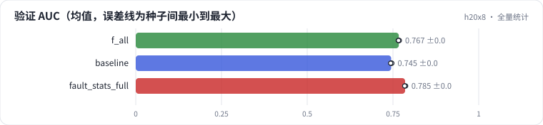

<!-- 本页由 python -m labkit docs 从 ../lesson.yaml 和 results/ 生成，不要手改 -->

[← T+1 天级统计](15-daily.md) · [课程首页](../README.md) · [诊断：全量统计的分数从哪来 →](17-diagnose.md)

# 第 16 步 / 共 19 步：全量统计

> 阶段 6 / 7：**口径泄漏** · 场景：`fault_stats_full`（对照 `f_all`）

同事写特征的方式：先用全量评分日志按用户、按电影聚合出次数和喜欢率，再 join 回每一行样本——一条 SQL 搞定，比按时间算快得多。和"全部特征"只差这一个参数。离线训练、验证都用这份特征。

## 这一步跑了什么

| 场景 | 作用 | 说明 | 相对基线改了什么 | 种子（H20） |
| - | - | - | - | - |
| `f_all` | 对照 | 5 组特征全加（时点正确），5 个种子 | `feature_groups=['ids', 'user_profile', 'item_attr', 'user_stats', 'item_stats']` | 5 |
| `baseline` | 参照 | 基线：只用用户 ID + 电影 ID（= R0a 基线），5 个种子 | — | 5 |
| `fault_stats_full` | 本步 | 全部特征，统计用全量日志按用户 / 电影聚合后拼回每一行 | `feature_groups=['ids', 'user_profile', 'item_attr', 'user_stats', 'item_stats']`, `stats_mode=full` | 3 |

## 先预测

**全量统计的验证 AUC，比时点正确的"全部特征"高多少？**

- **A.** 高不到 1 个点
- **B.** 高 1 - 3 个点
- **C.** 高 3 个点以上

> 先选定一个（记下来），再展开下面的实测。AUC 差异小于 0.3 个百分点（GAUC 小于 0.5）或小于种子间波动，都按“差不多”算。

## 实测

展开实测：H20 · MovieLens-1M 全量 · 在 R0a 基线上逐组加特征、换统计口径 · 3-5 种子（已有 13 / 13 个运行）

| 场景 | 类型 | 验证 AUC | 同一批行·线上口径 | 留出 AUC | 含未来的行占比 | 验证 AUC：与 `f_all` 差 | 验证 AUC：各种子 | 断言 |
| - | - | - | - | - | - | - | - | - |
| `f_all` | 修复 | 0.7670 ± 0.0014 | 0.7670 ± 0.0014 | 0.7676 ± 0.0009 | 0.00 ± 0.00 | — | s0 0.7675 / s1 0.7675 / s2 0.7651 / s3 0.7688 / s4 0.7663 | 通过 |
| `baseline` | 基线 | 0.7449 ± 0.0015 | 0.7449 ± 0.0015 | 0.7533 ± 0.0003 | 0.00 ± 0.00 | -0.0222 | s0 0.7447 / s1 0.7437 / s2 0.7458 / s3 0.7469 / s4 0.7433 | 通过 |
| `fault_stats_full` | 教学故障 | 0.7853 ± 0.0015 | 0.7706 ± 0.0008 | 0.7627 ± 0.0006 | 0.99 ± 0.00 | +0.0183 | s0 0.7871 / s1 0.7848 / s2 0.7841 | 通过 |

运行目录（每个目录里有 `summary.json` 指标、`evidence.json` 证据摘要、`predictions.jsonl` 逐条预测、`log.txt` 日志）：

- `f_all` [s0](../../../results/h20x8/R0b/f_all/s0-55a121/) · [s1](../../../results/h20x8/R0b/f_all/s1-b243f6/) · [s2](../../../results/h20x8/R0b/f_all/s2-dd3fa1/) · [s3](../../../results/h20x8/R0b/f_all/s3-2ff37a/) · [s4](../../../results/h20x8/R0b/f_all/s4-7ddea0/)
- `baseline` [s0](../../../results/h20x8/R0b/baseline/s0-461376/) · [s1](../../../results/h20x8/R0b/baseline/s1-71c585/) · [s2](../../../results/h20x8/R0b/baseline/s2-570ea7/) · [s3](../../../results/h20x8/R0b/baseline/s3-a5952b/) · [s4](../../../results/h20x8/R0b/baseline/s4-e7e664/)
- `fault_stats_full` [s0](../../../results/h20x8/R0b/fault_stats_full/s0-74a5bf/) · [s1](../../../results/h20x8/R0b/fault_stats_full/s1-91ce98/) · [s2](../../../results/h20x8/R0b/fault_stats_full/s2-475818/)

## 看完实测再想一步

验证 AUC 和留出 AUC 的方向一致吗？

---

[← T+1 天级统计](15-daily.md) · [课程首页](../README.md) · [诊断：全量统计的分数从哪来 →](17-diagnose.md)
