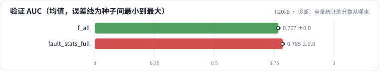

<!-- 本页由 python -m labkit docs 从 ../lesson.yaml 和 results/ 生成，不要手改 -->

[← 全量统计](16-fault.md) · [课程首页](../README.md) · [只多算了本行的标签 →](18-self.md)

# 第 17 步 / 共 19 步：诊断：全量统计的分数从哪来

> 阶段 6 / 7：**口径泄漏** · 场景：`fault_stats_full`（对照 `f_all`）

配置只差统计口径一个参数，验证 AUC 多涨了一两个点，所有分组都在涨。按需逐级点开线索，然后点选最主要的原因。

## 这一步跑了什么

| 场景 | 作用 | 说明 | 相对基线改了什么 | 种子（H20） |
| - | - | - | - | - |
| `f_all` | 对照 | 5 组特征全加（时点正确），5 个种子 | `feature_groups=['ids', 'user_profile', 'item_attr', 'user_stats', 'item_stats']` | 5 |
| `fault_stats_full` | 本步 | 全部特征，统计用全量日志按用户 / 电影聚合后拼回每一行 | `feature_groups=['ids', 'user_profile', 'item_attr', 'user_stats', 'item_stats']`, `stats_mode=full` | 3 |

## 线索

逐条展开，看到能下判断为止。

线索 1

线上回放：固定留出集（线上口径特征）上，时点正确 0.7676 ± 0.0009，全量统计 0.7627 ± 0.0006。离线涨，线上回放持平还是下跌？

线索 2

口径体检：用户统计里数进了未来的行占比 0.99 ± 0.00（时点正确为 0.00 ± 0.00）。只用"用户喜欢率"排序的 AUC：训练集 0.7009 ± 0.0000，同一批验证行换线上口径 0.6882 ± 0.0000。

线索 3

同一个模型、同一批验证行，只换特征口径：0.7853 ± 0.0015 → 0.7706 ± 0.0008。样本之前没有任何历史的用户（u_new）：全量口径 0.7487 ± 0.0012，时点正确 0.7221 ± 0.0014。

## 先预测

**全量统计的验证 AUC 更高，最主要的原因是什么？**

- **A.** 统计量里含有本行的标签和未来的行为，线上拿不到（穿越）
- **B.** 全量统计样本多，估计更准
- **C.** 模型过拟合
- **D.** 验证集换了一批更容易的样本

> 先选定一个（记下来），再展开下面的实测。AUC 差异小于 0.3 个百分点（GAUC 小于 0.5）或小于种子间波动，都按“差不多”算。

## 实测

展开实测：H20 · MovieLens-1M 全量 · 在 R0a 基线上逐组加特征、换统计口径 · 3-5 种子（已有 8 / 8 个运行）

| 场景 | 类型 | 验证 AUC | 线上口径（同一批行） | 留出 AUC | 含未来的行占比 | 此前 0 次评分的用户 AUC | 验证 AUC：与 `f_all` 差 | 验证 AUC：各种子 | 断言 |
| - | - | - | - | - | - | - | - | - | - |
| `f_all` | 修复 | 0.7670 ± 0.0014 | 0.7670 ± 0.0014 | 0.7676 ± 0.0009 | 0.00 ± 0.00 | 0.7221 ± 0.0014 | — | s0 0.7675 / s1 0.7675 / s2 0.7651 / s3 0.7688 / s4 0.7663 | 通过 |
| `fault_stats_full` | 教学故障 | 0.7853 ± 0.0015 | 0.7706 ± 0.0008 | 0.7627 ± 0.0006 | 0.99 ± 0.00 | 0.7487 ± 0.0012 | +0.0183 | s0 0.7871 / s1 0.7848 / s2 0.7841 | 通过 |

运行目录（每个目录里有 `summary.json` 指标、`evidence.json` 证据摘要、`predictions.jsonl` 逐条预测、`log.txt` 日志）：

- `f_all` [s0](../../../results/h20x8/R0b/f_all/s0-55a121/) · [s1](../../../results/h20x8/R0b/f_all/s1-b243f6/) · [s2](../../../results/h20x8/R0b/f_all/s2-dd3fa1/) · [s3](../../../results/h20x8/R0b/f_all/s3-2ff37a/) · [s4](../../../results/h20x8/R0b/f_all/s4-7ddea0/)
- `fault_stats_full` [s0](../../../results/h20x8/R0b/fault_stats_full/s0-74a5bf/) · [s1](../../../results/h20x8/R0b/fault_stats_full/s1-91ce98/) · [s2](../../../results/h20x8/R0b/fault_stats_full/s2-475818/)

---

[← 全量统计](16-fault.md) · [课程首页](../README.md) · [只多算了本行的标签 →](18-self.md)
