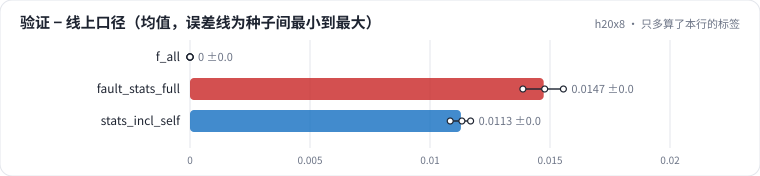

<!-- 本页由 python -m labkit docs 从 ../lesson.yaml 和 results/ 生成，不要手改 -->

[← 诊断：全量统计的分数从哪来](17-diagnose.md) · [课程首页](../README.md) · [回顾 →](19-keycard.md)

# 第 18 步 / 共 19 步：只多算了本行的标签

> 阶段 6 / 7：**口径泄漏** · 场景：`stats_incl_self`（对照 `f_all`）

更隐蔽的版本：统计严格按时间截断（没有未来），只是"截止到本行"时把本行也算进去了——比如用 `<=` 而不是 `<`，或者曝光日志和点击日志 join 时把当前这次点击也计入了历史点击。

## 这一步跑了什么

| 场景 | 作用 | 说明 | 相对基线改了什么 | 种子（H20） |
| - | - | - | - | - |
| `f_all` | 对照 | 5 组特征全加（时点正确），5 个种子 | `feature_groups=['ids', 'user_profile', 'item_attr', 'user_stats', 'item_stats']` | 5 |
| `fault_stats_full` | 参照 | 全部特征，统计用全量日志按用户 / 电影聚合后拼回每一行 | `feature_groups=['ids', 'user_profile', 'item_attr', 'user_stats', 'item_stats']`, `stats_mode=full` | 3 |
| `stats_incl_self` | 本步 | 全部特征，统计里多算了本行自己的标签 | `feature_groups=['ids', 'user_profile', 'item_attr', 'user_stats', 'item_stats']`, `stats_mode=include_self` | 3 |

## 先预测

**同一批验证行，"场景口径 − 线上口径"的 AUC 差有多大？**

- **A.** 不到 0.3 个点
- **B.** 0.3 - 1 个点
- **C.** 1 个点以上

> 先选定一个（记下来），再展开下面的实测。AUC 差异小于 0.3 个百分点（GAUC 小于 0.5）或小于种子间波动，都按“差不多”算。

## 实测

展开实测：H20 · MovieLens-1M 全量 · 在 R0a 基线上逐组加特征、换统计口径 · 3-5 种子（已有 11 / 11 个运行）

| 场景 | 类型 | 验证 − 线上口径 | 验证 AUC | 线上口径（同一批行） | 此前 0 次评分的用户 AUC | 长尾电影 AUC | 验证 − 线上口径：与 `f_all` 差 | 验证 − 线上口径：各种子 | 断言 |
| - | - | - | - | - | - | - | - | - | - |
| `f_all` | 修复 | +0.0000 ± +0.0000 | 0.7670 ± 0.0014 | 0.7670 ± 0.0014 | 0.7221 ± 0.0014 | 0.7457 ± 0.0035 | — | s0 +0.0000 / s1 +0.0000 / s2 +0.0000 / s3 +0.0000 / s4 +0.0000 | 通过 |
| `fault_stats_full` | 教学故障 | +0.0147 ± +0.0008 | 0.7853 ± 0.0015 | 0.7706 ± 0.0008 | 0.7487 ± 0.0012 | 0.7759 ± 0.0030 | +0.0147 | s0 +0.0156 / s1 +0.0148 / s2 +0.0139 | 通过 |
| `stats_incl_self` | 候选改动 | +0.0113 ± +0.0004 | 0.7891 ± 0.0012 | 0.7778 ± 0.0008 | 0.7648 ± 0.0006 | 0.7873 ± 0.0026 | +0.0113 | s0 +0.0117 / s1 +0.0113 / s2 +0.0108 | 通过 |

运行目录（每个目录里有 `summary.json` 指标、`evidence.json` 证据摘要、`predictions.jsonl` 逐条预测、`log.txt` 日志）：

- `f_all` [s0](../../../results/h20x8/R0b/f_all/s0-55a121/) · [s1](../../../results/h20x8/R0b/f_all/s1-b243f6/) · [s2](../../../results/h20x8/R0b/f_all/s2-dd3fa1/) · [s3](../../../results/h20x8/R0b/f_all/s3-2ff37a/) · [s4](../../../results/h20x8/R0b/f_all/s4-7ddea0/)
- `fault_stats_full` [s0](../../../results/h20x8/R0b/fault_stats_full/s0-74a5bf/) · [s1](../../../results/h20x8/R0b/fault_stats_full/s1-91ce98/) · [s2](../../../results/h20x8/R0b/fault_stats_full/s2-475818/)
- `stats_incl_self` [s0](../../../results/h20x8/R0b/stats_incl_self/s0-6b7892/) · [s1](../../../results/h20x8/R0b/stats_incl_self/s1-26568f/) · [s2](../../../results/h20x8/R0b/stats_incl_self/s2-4f56d9/)

## 看完实测再想一步

分组表里，哪一组的"虚高"最大？

---

[← 诊断：全量统计的分数从哪来](17-diagnose.md) · [课程首页](../README.md) · [回顾 →](19-keycard.md)
